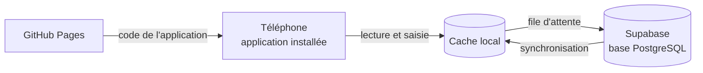

# Carnet de dépenses V2.4

Application personnelle de gestion des dépenses en FCFA, installable sur téléphone et utilisable hors ligne.
Version 2.4, octobre 2026. Auteur : Prince Quenauld Christian EKOUYA.

---

## 1. Ce que fait la V2

- **Saisie rapide** des dépenses et des **entrées d'argent** (salaire, prime, mission, autre), avec montants rapides.
- **Frais Mobile Money** : champ dédié pour MTN MoMo et Airtel Money, total du mois et de l'année.
- **Dépenses récurrentes** : loyer, forfait, factures, ajoutés automatiquement chaque mois au jour choisi.
- **Objectif d'épargne** : épargne du mois, cumul depuis le début, graphique sur 6 mois.
- **Bilan mensuel** : résumé du mois précédent affiché la première semaine du mois, et dans l'onglet Conseils.
- **Conseils Congo** : projection de fin de mois, propositions par poste, comparaison INS Brazzaville, budgets proposés.
- **Sauvegarde et restauration** complètes en fichier JSON, export CSV pour Excel.
- **Hors ligne** : saisie possible sans connexion, envoi automatique au retour du réseau.
- **Installable** sur l'écran d'accueil (PWA).

## 1 bis. Nouveautés de la V2.1

- Design conforme à la charte graphique (registre « Outil »), police Montserrat.
- Portefeuilles et mouvements : transferts, tontines, prêts, dettes, projets d'épargne.
- Budget par jour, reste à vivre, taux d'épargne, fonds d'urgence, dépenses inhabituelles.
- Onglet Analyse : graphiques et statistiques sur 3, 6 ou 12 mois, pouvoir d'achat corrigé de l'inflation.

**Mise à jour d'une base V2.0** : exécuter une fois `supabase/migration-2.1.sql` dans *SQL Editor*, avant ou juste après la mise en ligne.

## 2. Architecture

| Élément | Rôle |
|---|---|
| `index.html`, `styles.css`, `app.js` | L'application |
| `config.js` | Adresse et clé publique Supabase |
| `lib/supabase.js` | Bibliothèque supabase-js 2.117.2 (MIT), hébergée ici plutôt que sur un CDN |
| `sw.js`, `manifest.webmanifest`, `icons/` | Installation et fonctionnement hors ligne |
| `supabase/schema.sql` | Création des tables et des règles de sécurité |
| `docs/` | Cahier des charges, modèle de données, repères Congo |

## 3. Mise en service (une seule fois)

### 3.1 Supabase

1. Créer un projet sur supabase.com, région Europe.
2. *SQL Editor > New query* : coller le contenu de `supabase/schema.sql`, puis *Run*.
3. *Authentication > URL Configuration* : mettre l'adresse GitHub Pages dans *Site URL* (exemple : `https://ton-compte.github.io/carnet-depenses/`).
4. *Project Settings > API* : copier l'**URL du projet** et la **clé publique** (`anon` ou `publishable`) dans `config.js`.

> Ne jamais mettre la clé `service_role` dans le code : elle contourne toutes les protections.

### 3.2 GitHub Pages

1. Pousser le contenu de ce dossier dans le dépôt `carnet-depenses` (branche `main`).
2. *Settings > Pages* : *Source* = *Deploy from a branch*, branche `main`, dossier `/ (root)`.
3. L'application est disponible après une à deux minutes à l'adresse `https://ton-compte.github.io/carnet-depenses/`.

### 3.3 Premier lancement

1. Ouvrir l'adresse sur le téléphone, toucher **Créer mon compte**, confirmer l'e-mail reçu, puis se connecter.
2. Dans Supabase, *Authentication > Sign In / Providers* : désactiver **Allow new users to sign up**. Plus personne d'autre ne pourra créer de compte.
3. *Réglages > Restaurer un fichier* : importer une sauvegarde JSON si tu reprends des données existantes. Garde tes sauvegardes hors du dépôt public (le dossier `data/` est ignoré par Git).
4. Installer l'application : sur Android, menu ⋮ puis *Installer l'application* ; sur iPhone, *Partager* puis *Sur l'écran d'accueil*.

## 3 bis. Activer Face ID (une seule fois)

Dans Supabase, *Authentication > Passkeys* : activer, puis renseigner

| Champ | Valeur |
|---|---|
| Relying Party Display Name | Carnet de dépenses |
| Relying Party ID | ckp21.github.io |
| Relying Party Origins | https://ckp21.github.io |

Ensuite, dans l'application : *Réglages > Sécurité > Connexion avec Face ID > Activer*.

> Ne jamais modifier le Relying Party ID après coup : les clés déjà créées deviendraient inutilisables.

## 4. Sécurité

- Chaque ligne de la base porte l'identifiant de son propriétaire. Les règles RLS empêchent tout autre compte de la lire ou de la modifier.
- La clé publique présente dans `config.js` ne donne accès à rien sans connexion.
- Le dépôt public ne contient que le code, jamais les données personnelles. Si l'adresse Supabase change, mettre à jour aussi la politique CSP dans `index.html`.
- Politique CSP : scripts limités à l'application elle-même ; un script injecté ne s'exécute pas.
- La déconnexion efface la copie locale du téléphone.

## 5. Mettre à jour l'application

Modifier les fichiers, puis changer la constante `VERSION` dans `sw.js` (par exemple `carnet-v2.0.1`) avant de pousser. Les téléphones récupèrent la nouvelle version au lancement suivant.

## 6. Limites connues

- Structure de consommation INS de 2011 et prix alimentaires de 2022-2023 (voir `docs/reperes-cout-de-la-vie-congo.md`).
- En cas de modification du même élément sur deux appareils hors ligne, la dernière synchronisation l'emporte.
- Le bilan mensuel est calculé dans l'application ; il n'est pas envoyé par e-mail.
