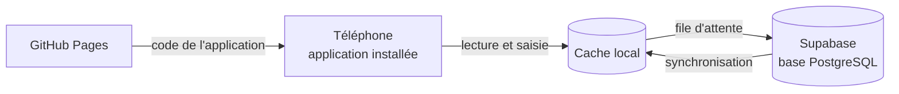
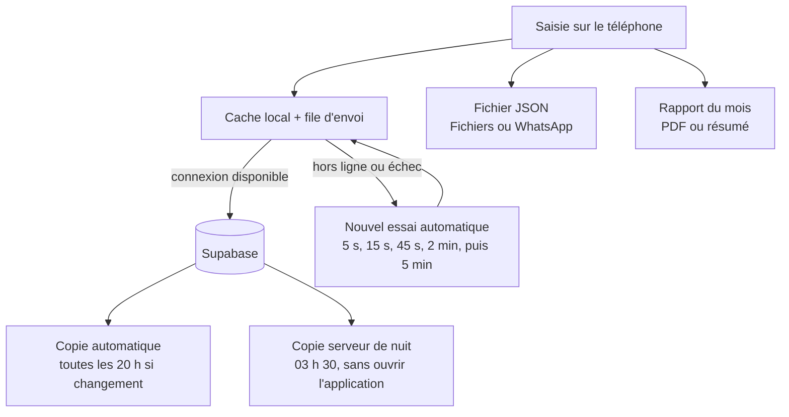

# Carnet de dépenses V2.7

Application personnelle de gestion des dépenses en FCFA, installable sur téléphone et utilisable hors ligne.
Version 2.7, octobre 2026. Auteur : Prince Quenauld Christian EKOUYA.

---

## 1. Ce que fait la V2

- **Saisie rapide** des dépenses et des **entrées d'argent** (salaire, prime, mission, autre), avec montants rapides.
- **Frais Mobile Money** : champ dédié pour MTN MoMo et Airtel Money, total du mois et de l'année.
- **Dépenses récurrentes** : loyer, forfait, factures. Chaque échéance apparaît « À payer » puis « Payé » quand tu confirmes le montant réel, le portefeuille et la date.
- **Objectif d'épargne** : épargne du mois, cumul depuis le début, graphique sur 6 mois.
- **Bilan mensuel** : résumé du mois précédent affiché la première semaine du mois, et dans l'onglet Conseils.
- **Conseils Congo** : projection de fin de mois, propositions par poste, comparaison INS Brazzaville, budgets proposés.
- **Sauvegarde et restauration** complètes en fichier JSON, export CSV pour Excel.
- **Hors ligne** : saisie possible sans connexion, envoi automatique au retour du réseau.
- **Installable** sur l'écran d'accueil (PWA).

## 1 bis. Nouveautés de la V2.1

- Design conforme à la charte graphique (registre « Outil »), police Montserrat.
- Portefeuilles et mouvements : transferts, tontines, prêts, dettes, projets d'épargne.
- Budget par jour, reste à vivre, taux d'épargne, fonds d'urgence, dépenses inhabituelles.
- Onglet Analyse : graphiques et statistiques sur 3, 6 ou 12 mois, pouvoir d'achat corrigé de l'inflation.

**Mise à jour d'une base V2.0** : exécuter une fois `supabase/migration-2.1.sql` dans *SQL Editor*, avant ou juste après la mise en ligne.

## 1 ter. Nouveautés de la V2.5

- **Catégories personnalisables** : renommer, recolorer, ajouter les tiennes (dîme, solidarité, coiffure, scolarité, groupe électrogène en un geste).
- **Cycle de paie** et scénario « salaire en retard » : combien de jours tu tiens, et quelle limite par jour respecter.
- **Modèles d'objectifs** : rentrée scolaire, terrain par tranches, caution de loyer, cérémonie, fêtes, chantier.
- **Rappels par notification** : loyer, tontines, dettes, projets, jour de paie, bilan du mois. Guide : `docs/notifications.md`.
- **Sauvegarde** : copie automatique quotidienne côté serveur (14 jours), restauration avec aperçu, fichier JSON partageable.
- **Synchronisation** : file d'envoi durable, nouvel essai automatique, indicateur d'état et journal dans Réglages.
- **Rapport mensuel** : document imprimable en PDF et résumé à envoyer par WhatsApp.
- **Police hébergée** : plus aucune requête vers un site externe en dehors de Supabase.

**Mise à jour d'une base V2.4** : exécuter `supabase/migration-2.5.sql` dans *SQL Editor* (relançable sans risque). Les rappels demandent en plus la fonction `send-reminders` et sa planification, voir `docs/notifications.md`.

## 1 quater. Nouveautés de la V2.6

- **Accueil allégé** : argent disponible, utilisable par jour jusqu'à la prochaine paie ou la fin du mois, prochaine échéance. Le reste est replié dans « Détails ».
- **Vérifier mon solde** : l'écart avec la réalité devient un ajustement daté et motivé, jamais une dépense.
- **Démarrage guidé** en 3 étapes, dépenses fréquentes en un geste, bouton Annuler, rappel du soir facultatif.
- **Séparation perso et pro** : filtre Tout, Perso, Pro, sans jamais modifier les soldes réels.
- **Opérations à corriger** : un envoi refusé par le serveur reste visible avec sa cause jusqu'à correction.
- **Récurrentes À payer / Payé** avec confirmation du montant réel.
- **Sauvegarde** : copie serveur de nuit, date de la dernière copie, restauration avec aperçu (ajoutés, remplacés, conservés). Guide : `docs/sauvegardes.md`.
- **Accès** : mot de passe oublié, changement de mot de passe, afficher le mot de passe.
- **Retours des testeurs** : « Envoyer le retour » et journal d'erreurs anonymisé. Guide : `docs/retours-testeurs.md`.
- **Tests dans le dépôt** et contrôle automatique GitHub : `tests/README.md`.

**Mise à jour d'une base V2.5** : exécuter `supabase/migration-2.6.sql` puis `supabase/cron-sauvegarde.sql` dans *SQL Editor* (relançables sans risque), et redéployer la fonction `send-reminders` (rappel du soir).

## 1 quinquies. Nouveautés de la V2.7

- **Accueil plus clair** : argent disponible, budget du jour avec ce qui reste aujourd'hui, prochaine sortie prévue. La date du jour est dans l'en-tête. Le choix « jusqu'à la prochaine paie » ou « jusqu'à la fin du mois » est dans Réglages.
- **Abonnements** (Plan > Abonnements) : prochain prélèvement, périodicité, coût mensuel équivalent, totaux par mois et par an, prix en USD ou EUR avec taux appris du montant réellement débité.
- **Carte prépayée** : portefeuille rechargé depuis Mobile Money, alerte « Recharge la carte avant le X : il faut N FCFA », bouton Recharger.
- **Détection** dans l'historique, rappels avant renouvellement, fin d'essai gratuit et changement de prix. Guide : `docs/abonnements.md`.

**Mise à jour depuis la V2.6** : rien à faire côté Supabase.

## 1 sexies. Nouveautés de la V2.8

- **Ma situation** (Réglages) : statut, logement, déplacements, personnes à charge. Les budgets proposés ne réservent plus rien pour ce que tu ne paies pas (loyer si tu es hébergé, transport si tes trajets sont pris en charge). Tes dépenses réelles passent toujours avant tes réponses. Guide : `docs/situation.md`.
- **Démarrage guidé en 4 étapes**, adapté au statut : indemnité pour un stagiaire, revenus irréguliers pour un indépendant, pension pour un retraité.
- **Fin de stage ou de contrat** : alerte sur l'accueil avec le nombre de mois que couvre ton argent, et conseil de fonds d'urgence à 6 mois pour un revenu instable.
- **Nouvelles lignes de budget** : soins du corps, sport et activités, abonnements en ligne, proposées d'après tes montants réels.
- **Types d'entrées plus variés**, en trois familles : revenus de travail, revenus de capital, prestations et dons.
- **2.8.1** : bandeau « Budget sans objet » (retirer en deux temps, annulable, ou « Je le paie ») et postes non payés repliés sous « Autres postes » dans les budgets.

**Mise à jour depuis la V2.7** : rien à faire côté Supabase.

## 2. Architecture

| Élément | Rôle |
|---|---|
| `index.html`, `styles.css`, `app.js` | L'application |
| `config.js` | Adresse et clé publique Supabase |
| `lib/supabase.js` | Bibliothèque supabase-js 2.117.2 (MIT), hébergée ici plutôt que sur un CDN |
| `sw.js`, `manifest.webmanifest`, `icons/` | Installation, fonctionnement hors ligne, réception des notifications |
| `fonts/` | Police Montserrat (licence OFL), hébergée dans le dépôt |
| `supabase/schema.sql` et `migration-*.sql` | Création et évolution des tables et des règles de sécurité |
| `supabase/functions/send-reminders/` | Fonction qui envoie les rappels (Web Push) |
| `supabase/cron-rappels.sql` | Modèle de planification de l'envoi, à remplir hors dépôt |
| `supabase/cron-sauvegarde.sql` | Planification de la copie serveur de nuit (aucun secret) |
| `tests/`, `.github/workflows/` | Tests automatiques et contrôle à chaque modification |
| `docs/` | Cahier des charges, modèle de données, repères Congo, notifications, sauvegardes, retours des testeurs |

## 3. Mise en service (une seule fois)

### 3.1 Supabase

1. Créer un projet sur supabase.com, région Europe.
2. *SQL Editor > New query* : coller le contenu de `supabase/schema.sql`, puis *Run*.
3. *Authentication > URL Configuration* : mettre l'adresse GitHub Pages dans *Site URL* (exemple : `https://ton-compte.github.io/carnet-depenses/`).
4. *Project Settings > API* : copier l'**URL du projet** et la **clé publique** (`anon` ou `publishable`) dans `config.js`.

> Ne jamais mettre la clé `service_role` dans le code : elle contourne toutes les protections.

### 3.2 GitHub Pages

1. Pousser le contenu de ce dossier dans le dépôt `carnet-depenses` (branche `main`).
2. *Settings > Pages* : *Source* = *Deploy from a branch*, branche `main`, dossier `/ (root)`.
3. L'application est disponible après une à deux minutes à l'adresse `https://ton-compte.github.io/carnet-depenses/`.

### 3.3 Premier lancement

1. Ouvrir l'adresse sur le téléphone, toucher **Créer mon compte**, confirmer l'e-mail reçu, puis se connecter.
2. Dans Supabase, *Authentication > Sign In / Providers* : désactiver **Allow new users to sign up**. Plus personne d'autre ne pourra créer de compte.
3. *Réglages > Restaurer un fichier* : importer une sauvegarde JSON si tu reprends des données existantes. Garde tes sauvegardes hors du dépôt public (le dossier `data/` est ignoré par Git).
4. Installer l'application : sur Android, menu ⋮ puis *Installer l'application* ; sur iPhone, *Partager* puis *Sur l'écran d'accueil*.

## 3 bis. Activer Face ID (une seule fois)

Dans Supabase, *Authentication > Passkeys* : activer, puis renseigner

| Champ | Valeur |
|---|---|
| Relying Party Display Name | Carnet de dépenses |
| Relying Party ID | ckp21.github.io |
| Relying Party Origins | https://ckp21.github.io |

Ensuite, dans l'application : *Réglages > Sécurité > Connexion avec Face ID > Activer*.

> Ne jamais modifier le Relying Party ID après coup : les clés déjà créées deviendraient inutilisables.

## 4. Sécurité

- Chaque ligne de la base porte l'identifiant de son propriétaire. Les règles RLS empêchent tout autre compte de la lire ou de la modifier.
- La clé publique présente dans `config.js` ne donne accès à rien sans connexion.
- Le dépôt public ne contient que le code, jamais les données personnelles. Si l'adresse Supabase change, mettre à jour aussi la politique CSP dans `index.html`.
- Politique CSP : scripts limités à l'application elle-même ; un script injecté ne s'exécute pas.
- La déconnexion efface la copie locale du téléphone.

## 5. Sauvegarde, synchronisation et rapports

| Niveau | Où | Durée de conservation |
|---|---|---|
| 1. Cache du téléphone | Navigateur de l'appareil | Jusqu'à la déconnexion |
| 2. Base Supabase | Serveur | Tant que le projet existe |
| 3. Copies automatiques | Table `backups` | 14 copies de l'application, 14 copies serveur de nuit, 6 copies manuelles |
| 4. Fichier JSON | Fichiers, WhatsApp, courriel | À ta charge, rappel après 45 jours |

Les niveaux 2 et 3 sont dans le même projet Supabase : la copie serveur protège d'une erreur de manipulation ou d'un oubli d'ouvrir l'application, pas de la perte du compte. Le niveau 4 est le seul qui te protège dans ce cas : télécharge un fichier chaque mois. L'offre gratuite de Supabase ne propose pas de sauvegardes téléchargeables et met le projet en pause après environ une semaine sans activité.

Restaurer ne supprime jamais rien : les éléments de la copie sont remis, le reste est conservé.

## 6. Mettre à jour l'application

1. Modifier les fichiers sur une branche (jamais directement sur `main`).
2. Changer `VERSION` dans `sw.js` (par exemple `carnet-v2.6.1`) et `APP_VERSION` dans `app.js` : `tests/node/sw.test.js` échoue si elles diffèrent.
3. Lancer `tests/run-all.sh`.
4. Ouvrir une demande de fusion (pull request) vers `main` : le contrôle automatique GitHub rejoue tous les tests.

Les téléphones récupèrent la nouvelle version au lancement suivant.

## 7. Limites connues

- Structure de consommation INS de 2011 et prix alimentaires de 2022-2023 (voir `docs/reperes-cout-de-la-vie-congo.md`).
- En cas de modification du même élément sur deux appareils hors ligne, la dernière synchronisation l'emporte.
- Le bilan mensuel est calculé dans l'application ; il n'est pas envoyé par e-mail. Une notification te prévient le 1er du mois.
- Les rappels demandent l'application installée sur l'écran d'accueil (iPhone 16.4 minimum) et un serveur de rappels configuré par toi (voir `docs/notifications.md`).
- La lecture automatique des SMS n'est pas possible dans une application web : la saisie se fait en collant le SMS.
- La copie serveur de nuit est dans le même projet Supabase que les données. Seul le fichier JSON téléchargé protège de la perte du compte.
- Le courriel de réinitialisation du mot de passe passe par le service de messagerie de Supabase, limité à quelques envois par heure et réservé à l'équipe du projet tant qu'aucun service d'envoi personnalisé (SMTP) n'est configuré. Pour un testeur extérieur, voir `docs/retours-testeurs.md`.
