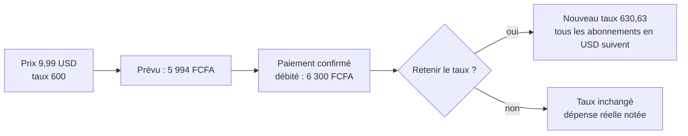

# Abonnements et carte prépayée

Guide de la version 2.7. Écran : **Plan > Abonnements**.

---

## 1. Ce que fait l'écran

- Liste chaque abonnement avec son prochain prélèvement, son prix et sa périodicité.
- Calcule le coût mensuel équivalent : un abonnement annuel de 60 000 FCFA compte 5 000 FCFA par mois.
- Affiche le total par mois et par an, et la répartition par moyen de paiement.
- Propose les abonnements qu'il détecte dans ton historique.

Le loyer, le forfait et les autres charges récurrentes déjà saisies apparaissent ici comme abonnements mensuels. Rien n'est modifié tant que tu ne touches à rien.

## 2. Ajouter un abonnement

1. **Ajouter un abonnement**, ou **Ajouter** sur une suggestion détectée.
2. Nom, prix, fréquence (mensuelle, trimestrielle, semestrielle, annuelle) et date du prochain prélèvement.
3. Moyen de paiement : la carte prépayée est proposée en premier si tu en as une.
4. Essai gratuit : coche « fin d'un essai gratuit » pour être prévenu la veille.
5. Prix qui va changer : indique la date et le nouveau prix, le carnet les applique tout seul.

## 3. Prix en dollars ou en euros

Choisis USD ou EUR et indique le taux : combien de FCFA valent 1 dollar ou 1 euro **pour ta carte**, frais de change compris. Le carnet convertit et garde le prix d'origine.

Le taux se règle aussi dans **Taux de change et frais de recharge**. Modifier un taux recalcule tous les abonnements dans cette devise.

**Le taux s'apprend** : quand tu confirmes un paiement avec le montant réellement débité, le carnet compare avec le montant prévu et propose de retenir le taux observé. Décoche la case pour ne rien changer.

## 4. Carte prépayée

Ajoute ta carte comme portefeuille (type « Carte prépayée »). Elle se recharge depuis Mobile Money par un transfert, avec les frais de recharge.

L'écran calcule pour les 30 prochains jours :

- ce qui va être prélevé sur la carte ;
- le solde disponible ;
- le montant à recharger et la date limite : « Recharge la carte avant le 25 octobre : il faut 15 494 FCFA de plus pour 2 abonnements ».

**Recharger** ouvre un transfert prérempli (montant manquant, frais compris). Une alerte apparaît sur l'accueil et un rappel est envoyé deux jours avant la date limite, sans montant dans la notification sauf si tu l'as choisi dans Réglages.

Si le solde de la carte est négatif, le carnet l'indique sans inventer de besoin : une recharge manque peut-être dans le carnet, « Vérifier mon solde » recale.

## 5. Rappels

| Rappel | Quand |
|---|---|
| Renouvellement annuel | 7 jours avant |
| Fin d'essai gratuit | la veille |
| Changement de prix annoncé | 3 jours avant |
| Recharge de la carte | 2 jours avant la date limite |

L'agenda exporté (Réglages) contient les abonnements avec leur vraie périodicité.

## 6. Pause, reprise, retrait

- **Mettre en pause** : plus d'échéance ni de rappel, rien n'est supprimé.
- **Retirer** : demande confirmation. Les dépenses déjà payées restent dans l'historique.

## 7. Où sont les données

Aucune nouvelle table. Un abonnement reste une ligne de `recurring` (montant en FCFA). Sa périodicité, son prix en devise et ses dates sont dans `settings.opening.__subs` (voir `docs/modele-de-donnees.md`). Elles suivent les sauvegardes et la restauration comme le reste.

## 8. Limites

- La lecture automatique des SMS n'existe pas dans une application web : le collage de SMS reste disponible.
- Le carnet ne connaît pas le vrai solde de la carte : il calcule d'après ce qui est noté. « Vérifier mon solde » sert à recaler.
- Le taux de change réel dépend de ta carte et de ta banque : c'est toi qui le règles, ou le carnet l'apprend de tes paiements.
