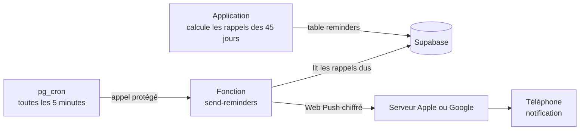

# Rappels par notification : mise en service

Le carnet prévient le téléphone même quand l'application est fermée : loyer et dépenses récurrentes, cotisations et réceptions de tontine, échéances de dettes, de prêts et de projets, jour de paie, salaire non noté, bilan du mois.

Par défaut, aucune notification ne contient de montant. L'option se règle dans *Réglages > Rappels par notification*.

Depuis la 2.6, un **rappel du soir** facultatif demande à 20 h : « As-tu noté tes dépenses d'aujourd'hui ? ». Il ne contient jamais de montant et n'est pas envoyé si une dépense est déjà notée ce jour-là.

---

## 1. Comment ça marche

L'application recalcule la liste à chaque synchronisation. Un rappel déjà envoyé n'est jamais renvoyé. Un rappel en retard de plus de 24 heures est abandonné plutôt que livré hors de propos.

**Rappel du soir** : l'application programme les 4 prochains soirs (identifiant `r-soir-<date>`, étiquette `soir`), sauf ceux où une dépense est déjà notée. Avant chaque envoi, la fonction vérifie encore la base : si une dépense existe à cette date, ou si le rappel a plus de 3 heures de retard, il est marqué « ignoré » dans la colonne `note` et rien n'est envoyé.

Heure de Brazzaville : UTC+1, sans changement d'heure. Le décalage maximal entre l'heure choisie et l'arrivée de la notification est de 5 minutes.

## 2. Ce qu'il faut côté iPhone

| Condition | Détail |
|---|---|
| iOS 16.4 ou plus récent | Réglages > Général > Informations |
| Application installée | Safari > Partager > Sur l'écran d'accueil |
| Ouverture par l'icône | Les notifications ne fonctionnent pas depuis un onglet Safari |
| Autorisation | Demandée quand tu touches **Activer** dans Réglages > Rappels |

Sur Android, Chrome suffit : l'installation n'est pas obligatoire.

## 3. Mise en service du serveur (une seule fois)

### 3.1 Base de données

*Supabase > SQL Editor* : exécuter `supabase/migration-2.4-securite.sql` si ce n'est pas déjà fait, puis `supabase/migration-2.5.sql`. Les fichiers peuvent être relancés sans risque. La 2.6 ajoute `supabase/migration-2.6.sql` (voir `docs/sauvegardes.md`).

À la fin, le résultat doit afficher `rowsecurity = true` pour `backups`, `push_subscriptions` et `reminders`.

### 3.2 Secrets de la fonction

*Supabase > Edge Functions > Secrets* : ajouter quatre secrets.

| Nom | Valeur |
|---|---|
| `VAPID_PUBLIC_KEY` | La clé publique déjà présente dans `config.js` (`VAPID_PUBLIC_KEY`) |
| `VAPID_PRIVATE_KEY` | La clé privée remise séparément. Ne jamais l'écrire dans le dépôt |
| `VAPID_SUBJECT` | `mailto:` suivi de ton adresse e-mail |
| `CRON_SECRET` | Une longue suite aléatoire (au moins 32 caractères), identique à celle du point 3.4 |

> Pour générer une nouvelle paire de clés : `npx web-push generate-vapid-keys`. Il faut alors mettre à jour `config.js` et le secret privé, puis réactiver les rappels sur chaque appareil.

### 3.3 Déployer la fonction

*Edge Functions > Deploy a new function > Via Editor* :

1. Nom : `send-reminders` (exactement).
2. Coller tout le contenu de `supabase/functions/send-reminders/index.ts`.
3. *Deploy*.
4. Ouvrir la fonction, onglet *Details* : désactiver **Verify JWT**. La fonction se protège elle-même avec `CRON_SECRET`, et la planification (point 3.4) n'envoie pas de jeton de connexion.

Avec l'outil en ligne de commande : `supabase functions deploy send-reminders --no-verify-jwt`.

> **Mise à jour 2.6** : si la fonction existe déjà, la redéployer avec le nouveau contenu de `index.ts`. Sans cela, le rappel du soir est envoyé même quand tu as déjà noté tes dépenses. Le réglage « Verify JWT » désactivé est conservé.

### 3.4 Planifier l'envoi

1. Ouvrir `supabase/cron-rappels.sql`.
2. Remplacer `REMPLACE_PAR_LE_SECRET` par la valeur de `CRON_SECRET`.
3. *SQL Editor* : exécuter. Le résultat affiche la tâche `carnet-rappels` active.

Ne publie jamais ce fichier une fois rempli. Dans le dépôt, il garde le texte de remplacement.

Contrôle : *SQL Editor* puis `select status, return_message, start_time from cron.job_run_details order by start_time desc limit 5;` doit montrer des exécutions `succeeded` toutes les 5 minutes.

### 3.5 Tester de bout en bout

1. Ouvrir le carnet depuis l'icône de l'écran d'accueil.
2. *Réglages > Rappels par notification > Activer* puis *Autoriser*.
3. Toucher **Envoyer un test**. Une notification arrive en moins de 5 minutes.
4. Toucher **Vérifier le test** : le carnet confirme que le serveur a bien livré le message.

## 4. Dépannage

| Constat | Cause probable | Solution |
|---|---|---|
| Le bouton Activer n'apparaît pas | Application ouverte dans Safari | L'installer sur l'écran d'accueil et l'ouvrir par l'icône |
| « Notifications refusées » | Autorisation refusée | iPhone : Réglages > Notifications > Carnet |
| Test jamais reçu, « Vérifier » dit non envoyé | Tâche planifiée absente ou secret différent | Refaire 3.4, comparer `CRON_SECRET` |
| « Vérifier » dit envoyé mais rien à l'écran | Mode Concentration, ou notifications coupées | Réglages > Notifications > Carnet > tout autoriser |
| Réponse 401 dans les journaux de la fonction | Verify JWT encore actif | Le désactiver (3.3) |
| Réponse 403 dans les journaux de la fonction | Le secret de la tâche diffère de `CRON_SECRET` | Aligner les deux |
| Plus de rappels après quelques semaines | Projet Supabase gratuit mis en pause (inactivité) | Rouvrir le tableau de bord pour le réactiver, puis ouvrir le carnet |
| Doublons après réinstallation | Ancienne inscription encore valide | Elle est supprimée automatiquement au premier échec du serveur Apple |

Journaux de la fonction : *Edge Functions > send-reminders > Logs*.

## 5. Sécurité

- La clé privée VAPID n'existe que dans les secrets Supabase.
- La fonction refuse tout appel sans l'en-tête `x-cron-secret` correct (comparaison à temps constant) et n'accepte que la méthode POST.
- Les tables `reminders`, `push_subscriptions` et `backups` sont limitées au propriétaire par les règles RLS ; le rôle anonyme n'a aucun droit.
- Le message est chiffré de bout en bout entre le serveur et le téléphone. Il contient un titre, une phrase et, si tu l'actives, un montant.
- La déconnexion supprime l'inscription de l'appareil dans la base.
- Le service worker plafonne la taille du titre et du texte et ignore tout lien reçu : toucher une notification ouvre uniquement le carnet.
