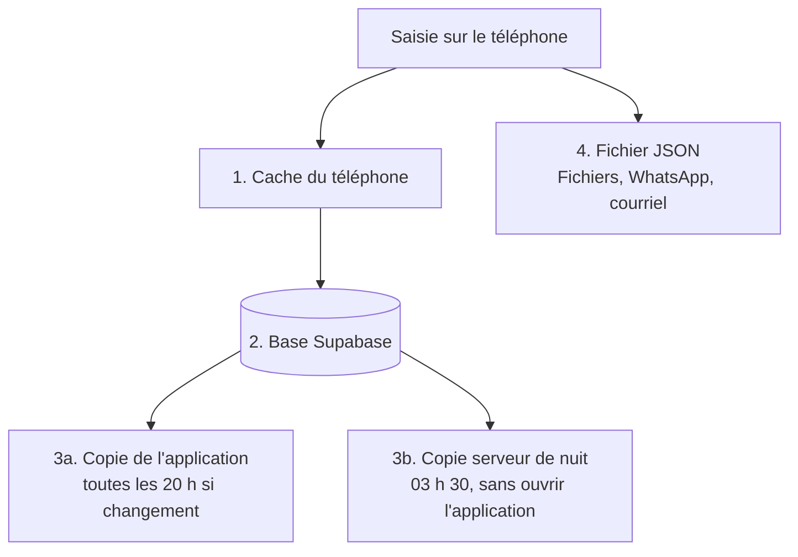

# Sauvegardes : comment tes données sont protégées

Quatre niveaux, du plus rapide au plus sûr. Seul le dernier te protège si le compte Supabase disparaît.

| Niveau | Où | Conservation | Protège de |
|---|---|---|---|
| 1. Cache du téléphone | Appareil | Jusqu'à la déconnexion | Coupure réseau |
| 2. Base Supabase | Serveur | Tant que le projet existe | Perte ou changement de téléphone |
| 3a. Copie de l'application | Table `backups`, type `auto` | 14 dernières | Erreur de saisie, suppression par erreur |
| 3b. Copie serveur de nuit | Table `backups`, type `serveur` | 14 dernières | Idem, même si tu n'as pas ouvert l'application |
| 3c. Copie manuelle | Table `backups`, type `manuel` | 6 dernières | Avant une opération risquée |
| 4. Fichier JSON | Fichiers, WhatsApp, courriel | À ta charge | Perte du compte ou du projet Supabase |

Les niveaux 2 et 3 vivent dans le même projet Supabase. Si le projet est supprimé ou bloqué, ils disparaissent avec lui. C'est pourquoi l'application te rappelle de télécharger un fichier JSON (après 45 jours sans fichier).

## 1. Copie serveur de nuit

Chaque nuit à 03 h 30 (Brazzaville), la base enregistre une copie complète de tes données, à une condition : le contenu a changé depuis la copie précédente. La comparaison se fait sur une empreinte du contenu, pas sur sa taille, donc la modification d'un seul budget suffit. Rien à ouvrir, rien à lancer.

### Mise en service (une seule fois)

1. *Supabase > SQL Editor* : exécuter `supabase/migration-2.6.sql`. Il ajoute le type de copie `serveur` et la fonction `snapshot_backups()`.
2. Exécuter `supabase/cron-sauvegarde.sql`. Il planifie la tâche `carnet-sauvegarde` ; le résultat doit afficher `active = true`.
3. Essai immédiat, facultatif : `select public.snapshot_backups();` renvoie le nombre de copies créées.
4. Dans le carnet : *Réglages > Sauvegarde*. La ligne « Copie serveur de nuit » affiche une date dès le lendemain matin.

Contrôle des exécutions : `select status, return_message, start_time from cron.job_run_details where jobid = (select jobid from cron.job where jobname = 'carnet-sauvegarde') order by start_time desc limit 5;`

## 2. Ce que tu vois dans l'application

*Réglages > Sauvegarde* affiche trois dates :

- **Dernière copie réussie** : date, heure et « il y a N min, h ou j », toutes origines confondues.
- **Copie serveur de nuit** : date de la dernière copie faite par la base, ou « non détectée » tant que la mise en service (point 1) n'est pas faite.
- **Dernier fichier téléchargé** : date, ou « jamais ».

Si aucune copie n'existe ou si la dernière date de plus de 3 jours, l'avertissement « Aucune copie récente » s'affiche. Après 45 jours sans fichier téléchargé, un rappel te propose d'en faire un.

## 3. Restaurer

*Réglages > Sauvegarde* : toucher **Restaurer** en face d'une copie de la liste (les copies de nuit portent la mention « serveur (nuit) »), ou **Restaurer un fichier** pour un fichier JSON. Un aperçu s'affiche avant toute chose :

| Colonne | Sens |
|---|---|
| Ajoutés | Éléments de la copie qui manquent aujourd'hui, ils seront remis |
| Remplacés | Même identifiant des deux côtés, contenu différent : la version de la copie prend la place (des exemples sont affichés) |
| Conservés | Présents aujourd'hui, absents de la copie : ils ne sont **pas** supprimés |

Annuler à cette étape ne change rien. Une fois la restauration confirmée, une copie de sécurité de l'état actuel est enregistrée juste avant, pour pouvoir revenir en arrière (si tu es connecté). Restaurer ne supprime jamais rien.

## 4. Le fichier JSON mensuel

C'est la seule copie hors de Supabase. *Réglages > Sauvegarde > Télécharger un fichier* : sur iPhone, choisir Enregistrer dans Fichiers ou envoyer par WhatsApp à soi-même. Une fois par mois suffit.

## 5. Limites de l'offre gratuite Supabase

- Pas de sauvegardes téléchargeables fournies par Supabase.
- Le projet est mis en pause après environ une semaine sans activité : la tâche de nuit ne tourne pas pendant la pause. Ouvrir le tableau de bord Supabase le réactive.
- Pour une vraie indépendance du serveur : le fichier JSON mensuel, ou l'offre payante avec restauration à un instant précis (Point-in-Time Recovery).
