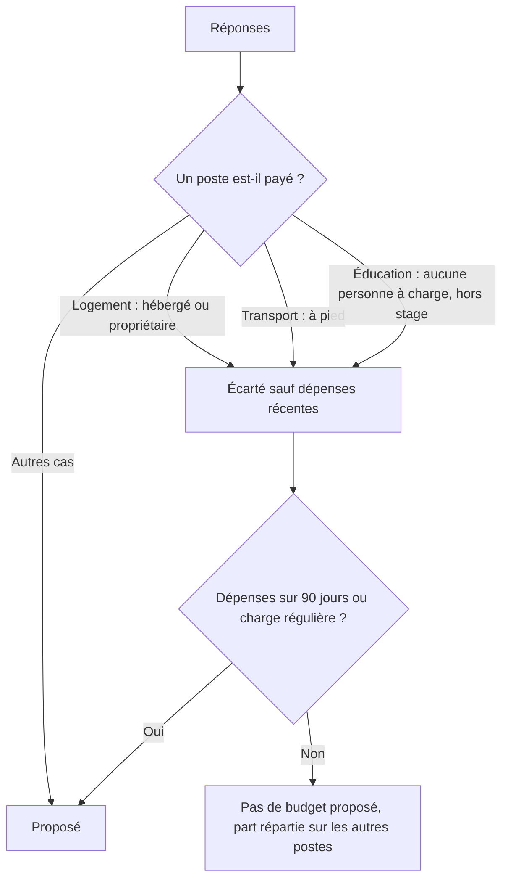

# Ma situation et budgets adaptés

Guide de la version 2.8. Écran : **Réglages > Ma situation** (premier bloc), et première étape du démarrage guidé.

---

## 1. À quoi ça sert

Deux personnes avec le même salaire n'ont pas les mêmes dépenses. Une personne hébergée ne paie pas de loyer, un stagiaire dont les trajets sont pris en charge n'a pas de budget transport. Le carnet pose quatre questions, toutes facultatives, et en tient compte dans les budgets proposés, les conseils et les alertes.

| Question | Réponses |
|---|---|
| Ma situation | Stagiaire ou étudiant, salarié en CDD, salarié en CDI ou fonctionnaire, indépendant, retraité, sans revenu régulier |
| Mon logement | Je loue, je suis propriétaire, je suis hébergé sans loyer |
| Mes déplacements | Taxi et bus, moto, voiture, à pied ou trajet pris en charge |
| Personnes à charge | Aucune, 1 ou 2, 3 ou plus |

## 2. Ce que le carnet en déduit

- **Les dépenses réelles passent avant les réponses.** Si tu as noté du transport dans les 90 derniers jours, le transport reste proposé même si tu as répondu « à pied ».
- **Ton choix manuel passe avant tout.** Dans « Postes que je paie », chaque case peut être cochée ou décochée. Une case touchée à la main n'est plus modifiée par les réponses.
- **Soins du corps, sport et abonnements en ligne** n'ont pas de repère national. Leur budget proposé vient de tes moyennes réelles (ou de tes charges régulières), plafonné à 15 % des entrées. Sans dépense notée, rien n'est proposé.

## 3. Fin de stage ou de contrat

Pour un stagiaire ou un CDD, une date de fin facultative est demandée. Dans les 90 jours qui précèdent, l'accueil affiche une alerte avec le nombre de mois que couvre ton argent disponible. Pour un revenu instable (stage, CDD, indépendant, sans revenu régulier), le carnet conseille de viser 6 mois de fonds d'urgence, avec un bouton pour le régler.

## 4. Démarrage guidé

Quatre étapes : situation, soldes, revenu, charges fixes. Le texte du revenu change selon le statut, le type d'entrée enregistré aussi (indemnité de stage, honoraires et missions, pension). Un indépendant n'est pas relancé pour un jour de paie : son budget du jour va jusqu'à la fin du mois. Une personne hébergée ne se voit pas proposer de loyer.

## 5. Où sont stockées les réponses

Dans `settings.opening.__profil`, sans colonne nouvelle. Elles sont assainies à chaque lecture et à l'import. Supprimer toutes les réponses supprime la clé. Voir `docs/modele-de-donnees.md`.

## 6. Retour à l'état précédent

Vider les quatre réponses et remettre les cases par défaut supprime `__profil` : les budgets proposés redeviennent ceux de la 2.7, avec tous les postes habituels.
